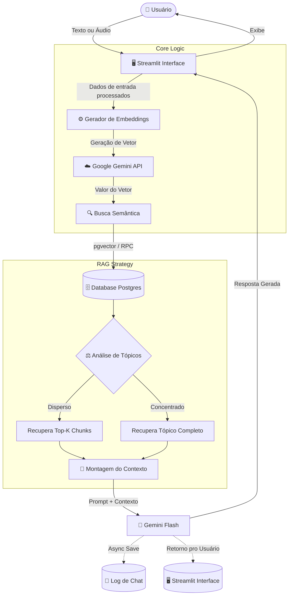
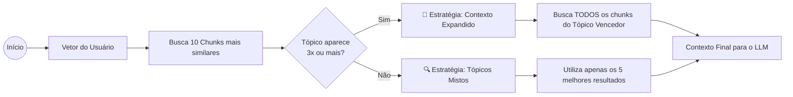
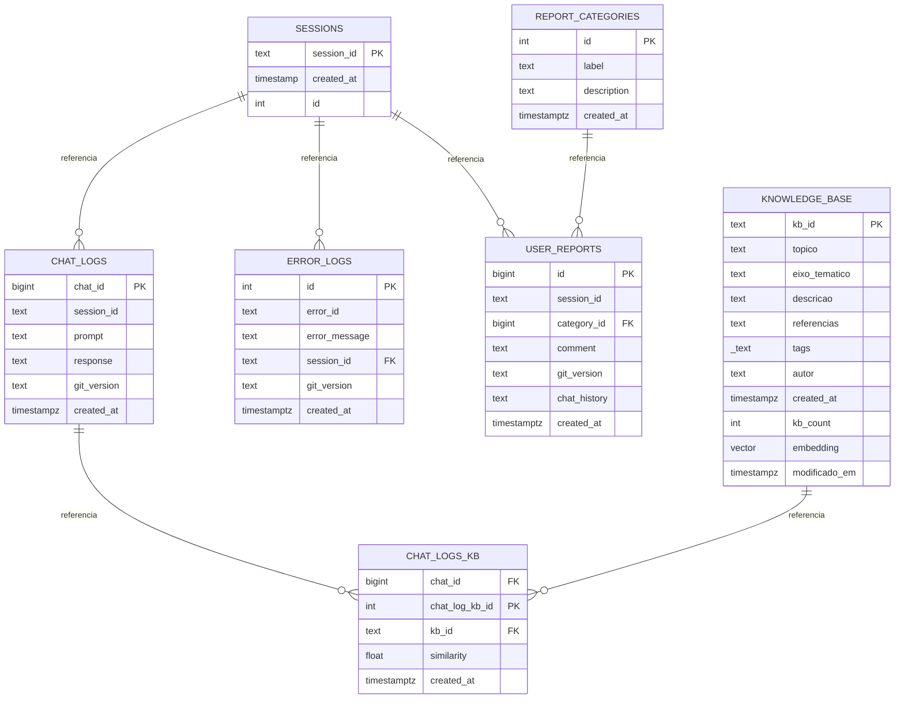

# 🏗️ Arquitetura de Dados e RAG no Vox AI

Este documento detalha a arquitetura técnica do Vox AI, com foco no fluxo de dados, esquema do banco de dados (Supabase) e na estratégia de recuperação de informação (RAG) inteligente.

## 🔄 Fluxo de Execução (Runtime Flow)

O diagrama abaixo ilustra o ciclo de vida de uma interação do usuário, desde a entrada do prompt até a geração da resposta e o log assíncrono.

## 🧠 Lógica de Recuperação Inteligente (Smart RAG)

O Vox utiliza o PostgreSQL com a extensão `pgvector` gerenciado pelo Supabase.

Abaixo estão as principais funções arquiteturais.

## 🗄️ Database Schema (ER Diagram)
O sistema utiliza Supabase (PostgreSQL) com as extensões `vector` e `pg_graphql`.
Abaixo, o diagrama de Entidade-Relacionamento das tabelas principais.

### Detalhe das Tabelas Principais
* `knowledge_base`: O núcleo do conhecimento. Utilizamos índices HNSW na coluna de embedding para performance em escala. Inclui a coluna `kb_count` incrementada via Trigger para métricas de utilidade.

* `chat_logs_kb`: Tabela pivot fundamental para auditoria. Ela conecta uma resposta da IA (`chat_logs`) aos fragmentos exatos de conhecimento (`kb_id`) que foram usados para gerá-la, permitindo rastrear a fonte de possíveis alucinações.

* `user_reports`: Conectada à tabela `report_categories`, permite que usuários classifiquem erros (ex: "Alucinação", "Ofensivo") para posterior análise da curadoria.

## 🔒 Privacidade, Governança e LGPD

O Vox AI foi desenhado seguindo princípios de *Privacy by Design* e em conformidade com a Lei Geral de Proteção de Dados (LGPD). As diretrizes arquiteturais implementadas são:

1. **Row Level Security (RLS) Restrito (Art. 46):** Todas as tabelas transacionais de dados e logs (`chat_logs`, `sessions`, `error_logs`, `user_reports`) são blindadas. Não existem políticas públicas de leitura ou escrita concedidas à `anon_key` pública. A comunicação é realizada pelo backend Streamlit no servidor via chave `service_role` privada.
2. **Minimização de Dados (Art. 6, III):** O envio de relatórios de denúncia restringe a captura do histórico de conversas a no máximo 6 mensagens (3 turnos), armazenando apenas o contexto imediato do incidente.
3. **Descarte Automático e Retenção (Art. 15 e 16):** Um job automático configurado no PostgreSQL via `pg_cron` executa semanalmente a exclusão permanente de registros de logs de chat, erros e sessões com mais de 12 meses de criação.
4. **Direito de Eliminação (Art. 18):** Disponibilizamos a opção de exclusão sob demanda na interface. O acionamento executa um comando de exclusão em cascata (`DELETE`) no banco de dados para todas as referências associadas ao `session_id` atual.

## 🚀 Evolução Arquitetural v5.0.0

A versão 5.0.0 do Vox AI introduziu componentes de grande porte para desacoplamento, robustez multimodal e segurança:

1. **Desacoplamento de Backend (API REST Headless):**
   - Criação da camada `src/api/service.py` e `src/api/routes.py` utilizando FastAPI.
   - O core do Vox AI opera de forma independente da interface gráfica do Streamlit, permitindo o consumo por bots externos (WhatsApp, Telegram) e futuras aplicações mobile.

2. **Áudio Nativo Gemini (STT & TTS):**
   - Módulo `src/core/audio.py` com suporte à transcrição de áudio via API multimodal do Gemini e síntese de voz (TTS) em alta fidelidade (PCM 24 kHz WAV).
   - Resiliência integrada com fallback transparente para síntese alternativa quando necessário.

3. **Resiliência Multi-Modelo (LLM Cascade):**
   - Estratégia de fallback automático em cascata entre modelos Gemini (`gemini-3.6-flash`, `gemini-3.1-flash-lite`, `gemini-2.5-flash`), evitando interrupções em caso de 429 (rate-limit) ou indisponibilidade temporária.

4. **Pipeline de Ingestão e Curadoria com IA:**
   - Tabela de staging `conteudo_pendente` para revisão human-in-the-loop antes da publicação definitiva na base de conhecimento.
   - Script de auditoria e métricas vetoriais `scripts/audit_kb.py` com cálculo de similaridade por cosseno e diagnóstico temático.

5. **Infraestrutura e DevOps:**
   - GitHub Actions modernizado com Node 22 (LTS), `astral-sh/setup-uv@v5`, `actions/setup-python@v5`, `supabase/setup-cli@v3` (v2.84.2 fixada) e `semgrep/semgrep:1.183.0`.
   - Relatórios automáticos de execução via `$GITHUB_STEP_SUMMARY` em todos os fluxos de trabalho.

### Stack Tecnológica v5.0.0
* ***Backend & Core***: Python 3.13, FastAPI, Uvicorn, Streamlit
* ***Vector Store & Database***: Supabase (PostgreSQL 15+, `pgvector`, RLS restrito)
* ***LLM, Embeddings & Áudio***: Google Gemini (`gemini-3-flash-preview`, `gemini-3.8-flash-tts`, `gemini-embedding-001`)
* ***Segurança & SAST***: Semgrep SAST 1.183.0, Gatekeep Pre-Push Hook, RLS Policies
* ***CI/CD & DevOps***: GitHub Actions (Node 22 LTS), Git Cliff, uv, Hugging Face Spaces (Streamlit SDK 1.67.0)
---

    
© 2026 Vox AI: Segurança para ser quem você é.

