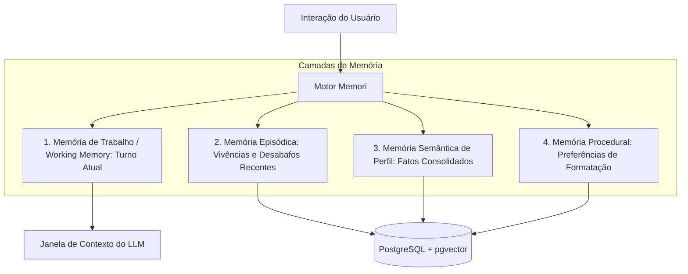

# Pesquisa e Arquitetura de Memória Persistente com a Biblioteca Memori e PostgreSQL

**Autor:** Equipe de Pesquisa e Engenharia de IA – Projeto Vox AI  
**Contexto:** Evolução da Memória Conversacional e Cidadania LGBTQIA+  
**Issue de Referência:** #102 ([feat/docs] biblioteca memori para memoria persistente)  
**Data:** 2026-11-07  

---

## 1. Introdução e Contexto do Problema no Vox AI

Atualmente, o Vox AI opera em modo majoritariamente *stateless* entre sessões: cada vez que uma pessoa usuária fecha o navegador ou acessa o assistente após alguns dias, todo o histórico contextual é reiniciado do zero.

Para aplicações comerciais convencionais (ex: consulta de catálogo de e-commerce), a ausência de memória inter-sessões é tolerável. Porém, no domínio do **apoio e cidadania LGBTQIA+**, essa efemeridade impõe um **custo emocional e cognitivo severo** às pessoas usuárias:
- **Fadiga de Narrativa (*Retraumatização*):** Pessoas trans, jovens expulsos de casa ou vítimas de discriminação precisam relatar repetidas vezes seus nomes sociais, seus pronomes preferidos, seu histórico familiar sensível e seu estágio atual na fila do SUS a cada interação.
- **Quebra de Vínculo de Confiança:** Um assistente que se propõe a ser *"um abraço em forma de texto"* perde grande parte de sua potência acolhedora quando trata um usuário frequente como um estranho absoluto a cada nova mensagem.

Para superar essa barreira respeitando estritamente a privacidade individual, este estudo analisa a arquitetura da biblioteca **Memori** e sua integração nativa com o banco de dados **PostgreSQL (Supabase)** através de **Stored Procedures** e índices vetoriais (`pgvector`).

---

## 2. Taxonomia de Memória Cognitiva em Agentes de IA

A biblioteca **Memori** baseia-se na psicologia cognitiva para estruturar a memória dos assistentes virtuais em quatro camadas distintas:



1. **Memória de Trabalho (*Working Memory*):** O histórico imediato dos últimos turnos dentro da sessão atual, mantido diretamente no buffer da API.
2. **Memória Episódica (*Episodic Memory*):** Ocorrências contextuais e temporais relatadas pelo usuário (ex: *"Fui ao cartório no Canela na segunda-feira passada e o atendente foi grosseiro"*).
3. **Memória Semântica de Perfil (*Semantic Fact Memory*):** Fatos extraídos, atemporais e consolidados sobre a identidade e necessidades do usuário (ex: `pronomes: ela/dela`, `nome_social: Maya`, `cidade: Salvador`, `situacao: retificacao_em_andamento`).
4. **Memória Procedural (*Procedural Memory*):** Como o usuário gosta de interagir (ex: prefere respostas ultra-curtas em tópicos, ou prefere explicações com gírias leves).

### 2.1 O Ciclo de Vida da Memória no Memori
O pipeline do Memori executa 4 fases assíncronas:
1. **Extração Inteligente:** Um modelo leve analisa a conversa ao final do turno e detecta declarações factuais do usuário (*"Eu me chamo João"*, *"Iniciei a PEP ontem"*).
2. **Deduplicação e Resolução Semântica:** O fato extraído é comparado via similaridade cosseno com as memórias já existentes para evitar duplicidade ou contradição.
3. **Recuperação Ponderada (*Scored Recall*):** Antes de responder a uma nova pergunta, as memórias mais relevantes são recuperadas com base em similaridade semântica, recência e relevância subjetiva.
4. **Decaimento Temporal (*Memory Decay*):** Memórias episódicas triviais perdem peso ao longo das semanas, enquanto fatos de perfil (como identidade) permanecem perenes.

---

## 3. Arquitetura de Integração com PostgreSQL / Supabase

Integrar o Memori diretamente ao **PostgreSQL** (já utilizado pelo Vox AI via Supabase) traz vantagens determinantes:
- Não adiciona infraestrutura externa nova (ex: Redis ou Pinecone separados).
- Mantém integridade transacional ACID.
- Permite executar lógica de busca híbrida e decaimento diretamente no banco através de **Stored Procedures (PL/pgSQL)** de altíssima performance.

### 3.1 Modelagem Relacional e Vetorial (`user_memories`)

```sql
-- Extensão pgvector para indexação vetorial
CREATE EXTENSION IF NOT EXISTS vector;

-- Tabela principal de memórias persistentes
CREATE TABLE IF NOT EXISTS user_memories (
    id UUID PRIMARY KEY DEFAULT gen_random_uuid(),
    user_hash VARCHAR(64) NOT NULL, -- Identificador criptográfico pseudonimizado (HMAC-SHA256)
    memory_type VARCHAR(32) NOT NULL, -- 'profile', 'preference', 'episodic', 'medical_alert'
    content TEXT NOT NULL, -- O fato textual (ex: "A usuária utiliza pronomes ela/dela")
    embedding vector(1536) NOT NULL, -- Embedding semântico gerado pelo Gemini
    importance_score REAL DEFAULT 0.5 CHECK (importance_score BETWEEN 0.0 AND 1.0),
    access_count INT DEFAULT 1,
    last_accessed_at TIMESTAMPTZ DEFAULT NOW(),
    created_at TIMESTAMPTZ DEFAULT NOW(),
    is_active BOOLEAN DEFAULT TRUE
);

-- Índices otimizados
CREATE INDEX IF NOT EXISTS idx_user_memories_user_hash ON user_memories(user_hash);
CREATE INDEX IF NOT EXISTS idx_user_memories_embedding ON user_memories 
    USING hnsw (embedding vector_cosine_ops)
    WITH (m = 16, ef_construction = 64);
```

---

## 4. Stored Procedures PL/pgSQL

Para garantir que a lógica de manipulação e busca de memórias seja atômica, performática e isolada do backend Python, foram desenhadas 4 funções nativas no PostgreSQL:

### 4.1 Inserção Inteligente com Deduplicação (`fn_upsert_user_memory`)
Se a nova memória tiver similaridade de cosseno superior a 0.88 com uma memória ativa já existente do mesmo usuário, o procedimento apenas atualiza a data e eleva o score de importância, evitando inchar o banco com registros redundantes.

```sql
CREATE OR REPLACE FUNCTION fn_upsert_user_memory(
    p_user_hash VARCHAR(64),
    p_memory_type VARCHAR(32),
    p_content TEXT,
    p_embedding vector(1536),
    p_importance REAL DEFAULT 0.5
)
RETURNS UUID
LANGUAGE plpgsql
AS $$
DECLARE
    v_existing_id UUID;
BEGIN
    -- Busca memória semanticamente idêntica existente
    SELECT id INTO v_existing_id
    FROM user_memories
    WHERE user_hash = p_user_hash
      AND is_active = TRUE
      AND (1 - (embedding <=> p_embedding)) >= 0.88
    LIMIT 1;

    IF v_existing_id IS NOT NULL THEN
        -- Atualiza registro existente (consolidação)
        UPDATE user_memories
        SET content = p_content,
            embedding = p_embedding,
            access_count = access_count + 1,
            importance_score = LEAST(1.0, importance_score + 0.1),
            last_accessed_at = NOW()
        WHERE id = v_existing_id;
        RETURN v_existing_id;
    ELSE
        -- Insere novo registro
        INSERT INTO user_memories (
            user_hash, memory_type, content, embedding, importance_score
        ) VALUES (
            p_user_hash, p_memory_type, p_content, p_embedding, p_importance
        )
        RETURNING id INTO v_existing_id;
        RETURN v_existing_id;
    END IF;
END;
$$;
```

### 4.2 Recuperação Ponderada com Decaimento Temporal (`fn_recall_user_memories`)
A recuperação calcula uma nota unificada combinando:
1. **Similaridade Semântica (Cosseno):** Quão próximo o fato está da pergunta atual do usuário.
2. **Decaimento Exponencial de Tempo:** $e^{-\lambda \Delta t}$, penalizando memórias episódicas que não são acessadas há semanas.
3. **Score de Importância Intrínseca:** Fatos cruciais (como nomes, pronomes ou alergias a medicamentos) possuem peso perene.

$$\text{Score} = (0.50 \times \text{Similaridade}) + (0.30 \times e^{-0.05 \cdot \text{Dias}}) + (0.20 \times \text{Importância})$$

```sql
CREATE OR REPLACE FUNCTION fn_recall_user_memories(
    p_user_hash VARCHAR(64),
    p_query_embedding vector(1536),
    p_limit INT DEFAULT 5,
    p_min_similarity REAL DEFAULT 0.45
)
RETURNS TABLE (
    memory_id UUID,
    memory_type VARCHAR(32),
    content TEXT,
    similarity REAL,
    combined_score REAL
)
LANGUAGE plpgsql
AS $$
BEGIN
    RETURN QUERY
    SELECT
        m.id AS memory_id,
        m.memory_type,
        m.content,
        (1 - (m.embedding <=> p_query_embedding))::REAL AS similarity,
        (
            (0.50 * (1 - (m.embedding <=> p_query_embedding))) +
            (0.30 * EXP(-0.05 * EXTRACT(DAY FROM (NOW() - m.last_accessed_at)))) +
            (0.20 * m.importance_score)
        )::REAL AS combined_score
    FROM user_memories m
    WHERE m.user_hash = p_user_hash
      AND m.is_active = TRUE
      AND (1 - (m.embedding <=> p_query_embedding)) >= p_min_similarity
    ORDER BY combined_score DESC
    LIMIT p_limit;

    -- Atualiza timestamp de último acesso das memórias recuperadas
    UPDATE user_memories
    SET last_accessed_at = NOW(),
        access_count = access_count + 1
    WHERE id IN (
        SELECT m.id FROM user_memories m
        WHERE m.user_hash = p_user_hash
          AND m.is_active = TRUE
          AND (1 - (m.embedding <=> p_query_embedding)) >= p_min_similarity
        ORDER BY (1 - (m.embedding <=> p_query_embedding)) DESC
        LIMIT p_limit
    );
END;
$$;
```

### 4.3 Exclusão Absoluta / Direito ao Esquecimento LGPD (`fn_purge_user_memories`)
Garante a exclusão irreversível de todos os dados do usuário com uma única transação segura:

```sql
CREATE OR REPLACE FUNCTION fn_purge_user_memories(
    p_user_hash VARCHAR(64)
)
RETURNS INT
LANGUAGE plpgsql
AS $$
DECLARE
    v_deleted_count INT;
BEGIN
    DELETE FROM user_memories
    WHERE user_hash = p_user_hash;
    
    GET DIAGNOSTICS v_deleted_count = ROW_COUNT;
    RETURN v_deleted_count;
END;
$$;
```

---

## 5. Privacidade, Ética e Conformidade Rigorosa com a LGPD

O armazenamento de histórico pessoal no contexto LGBTQIA+ lida com a categoria mais sensível da Lei Geral de Proteção de Dados (Art. 5º, II da Lei 13.709/2018 - dados sobre convicção religiosa, saúde e vida sexual).

### Diretrizes Inegociáveis Adotadas:
1. **Consentimento Explícito (*Opt-In* Obrigatório):**
   - O Vox AI jamais ativará a memória de longo prazo por padrão.
   - O usuário deve autorizar ativamente com um diálogo afetuoso e transparente:
     > *"Gostaria que o Vox lembrasse do seu nome social e das nossas conversas para você não precisar repetir tudo da próxima vez? Seus dados serão criptografados e você pode apagar tudo com um clique."*
2. **Pseudonimização Irreversível:**
   - Nenhum CPF, e-mail ou nome real é usado como chave de banco. O identificador `user_hash` é gerado via:
     $$\text{user\_hash} = \text{HMAC\_SHA256}(\text{ID\_Sessão\_Local}, \text{CHAVE\_SECRETA\_SERVIDOR})$$
3. **Direito ao Esquecimento Imediato (Art. 18 LGPD):**
   - O endpoint `DELETE /api/v1/session/{session_id}` ou um comando em chat (*"Vox, apague todas as minhas memórias"*) aciona imediatamente a procedure `fn_purge_user_memories`.
4. **Isolamento de Segurança via Row Level Security (RLS):**
   - Políticas estritas no Supabase impedem que a `anon key` faça queries indiscriminadas na tabela `user_memories`.

---

## 6. Comparativo de Soluções de Memória para Agentes

| Solução | Arquitetura | Vantagens | Desvantagens | Decisão Vox AI |
| :--- | :--- | :--- | :--- | :--- |
| **Memori + PostgreSQL / Stored Procedures** | Embutido no PostgreSQL nativo (`pgvector` + PL/pgSQL) | **Custo zero adicional, dados sob controle local, suporte nativo a transações e conformidade LGPD** | Exige manter e versionar as procedures SQL | **Adotado (Recomendado)** |
| **Mem0 (mem0ai)** | Serviço SaaS / Cloud híbrida | Fácil setup inicial, dashboard pronto | Dados sensíveis trafegam em nuvem de terceiros (risco LGPD grave) | Descartado para produção sensível |
| **LangChain ConversationBuffer** | In-Memory (Buffer RAM) | Simplicidade extrema | Não persiste entre sessões e estoura a janela de contexto | Insuficiente para memória longa |
| **MemGPT / Letta** | Sistema operacional de contexto com agentes | Extremamente sofisticado, suporta memória profunda | Footprint de infraestrutura muito pesado para o estágio do projeto | Manter no radar para v4.0 |

---

## 7. Exemplo de Integração em Python com a API do Vox

Abaixo, a implementação de referência da classe gerenciadora de memória pronta para ser instanciada no `src/api/service.py`:

```python
"""
Módulo de Integração de Memória Persistente (Memori + Supabase).
"""

from typing import List, Optional
import hashlib
import hmac
import os
from src.core.db.client import get_db_client
from src.config import logger

class PersistentMemoryManager:
    """Gerencia a persistência de memórias do usuário com garantia de privacidade e conformidade LGPD."""

    def __init__(self):
        self._secret_salt = os.getenv("MEMORY_SECRET_SALT", "vox_secure_default_salt_2026")
        self.client = get_db_client()

    def generate_user_hash(self, raw_user_id: str) -> str:
        """Gera hash HMAC-SHA256 irreversível para pseudonimizar o usuário."""
        return hmac.new(
            self._secret_salt.encode(),
            raw_user_id.encode(),
            hashlib.sha256
        ).hexdigest()

    def save_memory(
        self,
        raw_user_id: str,
        memory_type: str,
        content: str,
        embedding: List[float],
        importance: float = 0.5,
    ) -> Optional[str]:
        """Invoca a stored procedure fn_upsert_user_memory no PostgreSQL."""
        if not self.client:
            return None
        try:
            user_hash = self.generate_user_hash(raw_user_id)
            params = {
                "p_user_hash": user_hash,
                "p_memory_type": memory_type,
                "p_content": content,
                "p_embedding": embedding,
                "p_importance": importance,
            }
            res = self.client.rpc("fn_upsert_user_memory", params).execute()
            return res.data
        except Exception as e:
            logger.error(f"Erro ao salvar memória persistente: {e}")
            return None

    def recall_memories(
        self,
        raw_user_id: str,
        query_embedding: List[float],
        limit: int = 4,
    ) -> List[str]:
        """Recupera as memórias mais relevantes invocando fn_recall_user_memories."""
        if not self.client:
            return []
        try:
            user_hash = self.generate_user_hash(raw_user_id)
            params = {
                "p_user_hash": user_hash,
                "p_query_embedding": query_embedding,
                "p_limit": limit,
            }
            res = self.client.rpc("fn_recall_user_memories", params).execute()
            if res.data:
                return [row["content"] for row in res.data]
            return []
        except Exception as e:
            logger.warning(f"Erro ao recuperar memórias do usuário: {e}")
            return []

    def purge_user(self, raw_user_id: str) -> bool:
        """Exclui permanentemente todos os dados do usuário (LGPD Art. 18)."""
        if not self.client:
            return False
        try:
            user_hash = self.generate_user_hash(raw_user_id)
            self.client.rpc("fn_purge_user_memories", {"p_user_hash": user_hash}).execute()
            return True
        except Exception as e:
            logger.error(f"Erro ao expurgar memórias do usuário: {e}")
            return False
```

---

## 8. Conclusão

A arquitetura proposta com a biblioteca **Memori** e **PostgreSQL Stored Procedures** oferece a combinação perfeita entre afeto e responsabilidade ética. Ela transforma o Vox AI em um assistente com continuidade relacional genuína, eliminando a dor da repetição para pessoas vulneráveis e assegurando controle absoluto sobre os dados pessoais sensíveis com garantia técnica de conformidade com a LGPD.
