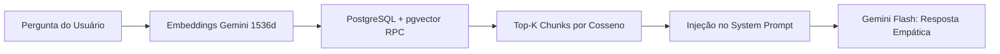
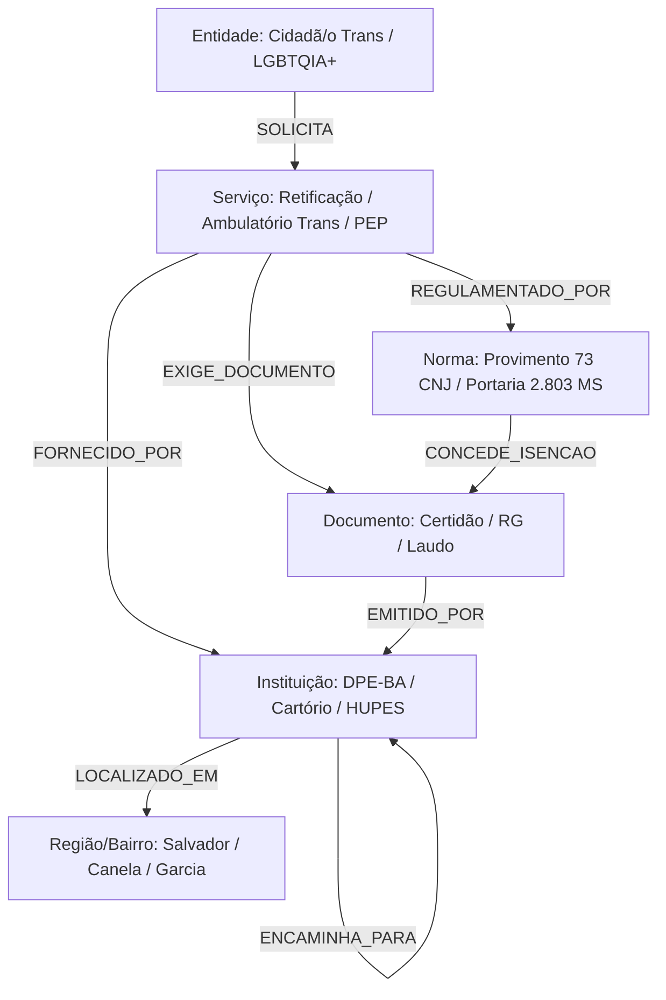
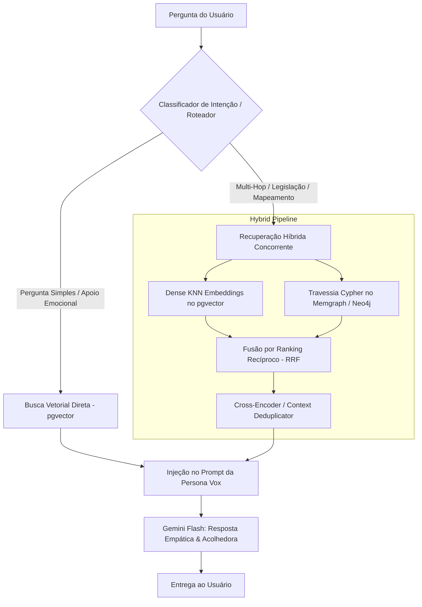

# Estudo Comparativo: RAG Vetorial vs. GraphRAG no Domínio LGBTQIA+

**Autor:** Equipe de Pesquisa e Engenharia de IA – Projeto Vox AI  
**Contexto:** Evolução Arquitetural do Módulo de Recuperação de Conhecimento  
**Issue de Referência:** #312 ([FEAT] RAG vs GraphRAG)  
**Data:** 2026-11-07  

---

## 1. Sumário Executivo e Contexto

O **Vox AI** tem como missão central democratizar o acesso a informações confiáveis sobre cidadania, saúde integral, direitos e acolhimento para a comunidade LGBTQIA+ no Brasil, com foco aprofundado na realidade local de Salvador e do estado da Bahia.

Historicamente, a arquitetura de recuperação de informação do Vox operou sobre um pipeline clássico de **RAG Vetorial Denso (Dense Vector RAG)**, empregando embeddings gerados via modelos Gemini e busca por similaridade de cosseno via extensão `pgvector` sobre o banco de dados PostgreSQL (Supabase).

Embora a abordagem vetorial ofereça excelente desempenho para responder a dúvidas conceituais diretas (ex: *"O que é PrEP?"* ou *"Qual o telefone do CVV?"*), o domínio de cidadania LGBTQIA+ é marcado por uma **rede densa e interconectada de dependências legais, institucionais, geográficas e temporais**. Usuários frequentemente trazem demandas multifacetadas que envolvem processos burocráticos encadeados (*multi-hop queries*), tais como:

> *"Sou uma mulher trans em situação de vulnerabilidade em Salvador. Fui expulsa de casa, perdi meus documentos e preciso retificar meu nome, conseguir acolhimento emergencial e iniciar a hormonização no SUS. Por onde começo e quais órgãos estão conectados?"*

Neste cenário, o RAG Vetorial tradicional enfrenta limites severos de fragmentação de contexto. Este documento apresenta um estudo aprofundado comparando **RAG Vetorial** e **GraphRAG (Retrieval-Augmented Generation baseado em Grafos de Conhecimento)**, avaliando motores de grafos de alta performance (**Neo4j**, **Memgraph**, **FalkorDB**), analisando o custo-benefício computacional e financeiro para o domínio e propondo uma **arquitetura de recuperação híbrida** para o ecossistema do Vox AI.

---

## 2. RAG Vetorial Denso: Arquitetura, Potencialidades e Gargalos

### 2.1 A Baseline Atual do Vox AI
O pipeline atual do Vox baseia-se na decomposição textual de cartilhas, leis, notas técnicas e mapeamentos de serviços em blocos (*chunks*) textuais de 500 a 1000 tokens, indexados na tabela `knowledge_base` do Supabase com vetores de 1536 dimensões (`gemini-embedding-001`).



### 2.2 Limitações Observadas no Domínio LGBTQIA+

1. **Incapacidade de Raciocínio Multi-Salto (*Multi-Hop Reasoning*):**
   - Na busca vetorial, a similaridade mede a proximidade semântica entre o prompt da query e pedaços de texto isolados. Se a resposta a uma dúvida depende de relacionar três entidades distintas (ex: *Provimento 73 CNJ* $\rightarrow$ *Certidão de Distribuidor da Justiça Federal* $\rightarrow$ *Gratuidade via DPE-BA*), e essas informações residem em documentos ou chunks separados, a busca vetorial raramente recupera todos os elos da cadeia com alta similaridade simultânea.
2. **Fragmentação de Fronteiras (*Chunk Boundary Disconnection*):**
   - Ao particionar leis e portarias em pedaços de tamanho arbitrário com pequeno overlap, quebram-se hierarquias normativas (ex: o caput de um artigo define a regra geral, mas o parágrafo 3º em outro chunk estipula a exceção para pessoas trans de baixa renda).
3. **Efeito *Lost in the Middle* e Diluição de Contexto:**
   - Injetar de 5 a 15 chunks recuperados por similaridade frequentemente introduz ruído e informações redundantes no prompt do modelo gerador, levando o LLM a alucinar detalhes burocráticos ou omitir órgãos parceiros críticos.
4. **Ausência de Consciência Global do Conhecimento:**
   - O RAG vetorial responde bem a *"Quem faz X?"*, mas falha estruturalmente ao responder perguntas holísticas de alto nível, como *"Qual é o panorama geral da rede de atendimento à população trans em Salvador?"*.

---

## 3. GraphRAG: Fundamentos, Paradigmas e Extração de Entidades

O **GraphRAG** enriquece ou substitui a indexação puramente vetorial por uma estrutura de **Grafo de Conhecimento (Knowledge Graph - KG)**, onde o conhecimento é modelado explicitamente como nós (entidades) e arestas direcionadas tipadas (relacionamentos e dependências).

### 3.1 Esquema Ontológico Proposto para o Vox AI

Para o domínio de cidadania e saúde LGBTQIA+, desenhou-se o seguinte modelo de grafo:



#### Tipos de Nós (Entities):
- `Cidadão / Perfil Vulnerável` (ex: População T, Jovens expulsos de casa, Vítimas de violência)
- `Instituição / Coletivo` (ex: Casa Marielle Franco, DECRADI, DPE-BA, HUPES/UFBA, CRAS)
- `Serviço Público / Apoio` (ex: Retificação de prenome e gênero, Processo Transexualizador, Profilaxia Pós-Exposição - PEP)
- `Documentação / Certidão` (ex: Certidão de Nascimento, Certidão de Quitação Eleitoral, Laudo Psicossocial)
- `Norma Jurídica / Marco Legal` (ex: Provimento 73/2018 CNJ, ADO 26 STF - Criminalização da Homotransfobia)
- `Geografia / Localidade` (ex: Salvador, Bairro Canela, Região Metropolitana de Salvador)

#### Tipos de Arestas (Relationships & Edges):
- `(Serviço)-[:EXIGE_DOCUMENTO]->(Documento)`
- `(Instituição)-[:OFERECE_SERVICO]->(Serviço)`
- `(Instituição)-[:ENCAMINHA_PARA]->(Instituição)`
- `(Norma)-[:GARANTE_DIREITO]->(Serviço)`
- `(Norma)-[:ISENTA_CUSTAS_SE]->(Condição)`

### 3.2 Extração de Entidades e Relacionamentos (Pipeline de Indexação)
A extração utiliza Large Language Models (LLMs) executando Named Entity Recognition (NER) e Relation Extraction de forma estruturada:
1. **Segmentação Textual Estruturada:** Divisão dos textos em unidades semânticas (artigos de lei, fichas de serviço institucional).
2. **Prompt de Extração Estruturada (Pydantic / Instructor):** Identificação de entidades, sinônimos (*aliasing*), propriedades e arestas com validação rigorosa de esquema.
3. **Resolução de Entidades (*Entity Resolution / Deduplication*):** Unificação de variantes textuais (ex: *"Defensoria Pública do Estado da Bahia"*, *"DPE-BA"*, *"Defensoria do Canela"* unificadas no mesmo nó institucional `ID: inst_dpe_ba`).
4. **Detecção de Comunidades (Algoritmo de Leiden):** Agrupamento de nós densamente conectados em clusters semânticos (ex: Cluster de Saúde Sexual / ISTs, Cluster de Retificação Registral, Cluster de Proteção a Vítimas de Violência).
5. **Síntese Hierárquica de Comunidades:** Geração de resumos temáticos de cada comunidade para permitir a **Busca Global (Global Search)** proposta pela Microsoft Research.

---

## 4. Benchmarking de Motores de Banco de Dados em Grafo

Para a infraestrutura do Vox AI, foram avaliados os três principais motores de grafos compatíveis com queries modernas em Cypher/GQL: **Neo4j**, **Memgraph** e **FalkorDB**.

| Critério de Avaliação | Neo4j (Enterprise / Community) | Memgraph | FalkorDB (antigo RedisGraph) |
| :--- | :--- | :--- | :--- |
| **Arquitetura Base** | Nativo em Java (JVM), orientado a disco com cache de páginas | Nativo em C++, 100% *In-Memory* com snapshots e WAL | Baseado em Redis, álgebra linear via GraphBLAS |
| **Linguagem de Consulta** | Cypher completo + APOC + GQL standard | OpenCypher (99% compatível com Neo4j) | OpenCypher |
| **Latência de Travessia Multi-Hop** | Média-Baixa (10–35 ms em grafos médios) | **Ultra-Baixa (1–5 ms, em memória nativa C++)** | **Ultra-Baixa (< 3 ms, multiplicação de matrizes esparsas)** |
| **Consumo de Memória (Footprint)** | Alto (~1.5 GB RAM inicial devido à JVM) | **Baixo (~150 MB RAM inicial, cresce linearmente)** | **Mínimo (~50 MB RAM inicial)** |
| **Busca Vetorial Integrada (Híbrida)** | Sim (índice vetorial nativo em nós) | Sim (índice vetorial integrado) | Sim (via ecossistema RediSearch/FalkorDB vector) |
| **Algoritmos de Grafo (Leiden / Louvain)** | Excelente (Neo4j Graph Data Science - GDS) | Muito Bom (MAGE - Memgraph Advanced Graph Extensions) | Limitado (focado em travessias e caminhos mínimos) |
| **Facilidade de Deploy / Self-Hosting** | Moderada (Docker, Helm, Neo4j AuraDB na nuvem) | **Alta (Binário único ou Docker leve sem JVM)** | **Alta (Módulo leve sobre Docker / Redis)** |
| **Adequação ao Vox AI** | ⭐⭐⭐⭐ (Ótimo para GDS, mas pesado para free tiers) | ⭐⭐⭐⭐⭐ **(Recomendado: C++, veloz, compatível e leve)** | ⭐⭐⭐⭐ (Excelente para buscas rápidas, menos maduro em comunidades) |

### 4.1 Por que o Memgraph se destaca para o Vox AI?
1. **Nenhum overhead de JVM:** Diferente do Neo4j, o Memgraph roda com menos de 200 MB de RAM em contêineres modestos (como os nós gratuitos ou básicos do Hugging Face Spaces, Render ou Docker VPS).
2. **Compatibilidade Transparente com Cypher:** Permite reutilizar toda a sintaxe de mercado (`MATCH (i:Instituicao)-[:ENCAMINHA_PARA]->(d:Instituicao) WHERE ... RETURN ...`).
3. **MAGE (Memgraph Advanced Graph Extensions):** Algoritmos nativos de detecção de comunidades (Leiden e Louvain) executados em C++ com alta eficiência para o GraphRAG.

---

## 5. Análise de Custo-Benefício no Domínio LGBTQIA+

### 5.1 Custo de Indexação (Tokenomics)
- **RAG Vetorial:**
  - Custo de $O(N)$, onde $N$ é o número de chunks. Cada chunk gera uma única chamada à API de embedding (ex: `gemini-embedding-001` custa fração de centavo por milhão de tokens).
  - Custo total de indexação da base do Vox (300 chunks): **< R$ 0,05**.
- **GraphRAG:**
  - Exige passagens de LLM sobre cada chunk para extrair entidades e relações ($O(N)$ chamadas de LLM para NER estruturado).
  - Exige resolução de entidades e geração de resumos hierárquicos de comunidade ($O(C)$ chamadas de LLM, onde $C$ é o número de comunidades).
  - Custo estimado para 300 chunks com Gemini Flash: **~R$ 2,50 a R$ 5,00** por reindexação completa da base.
  - **Conclusão:** O custo de indexação do GraphRAG é ~50x maior que o vetorial, mas em valores absolutos para a base do Vox, permanece **extremamente baixo e plenamente viável**.

### 5.2 Custo e Latência em Produção (Query-Time)
- **RAG Vetorial:** Latência típica de 40–80 ms no Supabase. Consumo de tokens restrito aos Top-5 chunks (~1.500 tokens de contexto).
- **GraphRAG (Local Search):** Latência de 10–25 ms para travessia Cypher + 1 chamada de inferência do LLM. O contexto retornado em grafo estruturado é até **40% mais conciso em tokens** que chunks textuais brutos, pois entrega relações diretas em vez de parágrafos redundantes.
- **GraphRAG (Global Search):** Consulta relatórios de comunidades de alto nível. Mais custoso em tokens (3.000–8.000 tokens), recomendado apenas para perguntas de panorama sistêmico.

### 5.3 Redução de Riscos Críticos (Fidelidade Factual)
No contexto LGBTQIA+, a precisão não é mero detalhe de engenharia:
- Informar incorretamente que um cartório pode exigir laudo psiquiátrico para retificação de nome (prática proibida pelo STF/CNJ) gera **violação de direitos e humilhação institucional**.
- O GraphRAG restringe as rotas de inferência a arestas formalmente validadas pela curadoria, **eliminando alucinações relacionais**.

---

## 6. Arquitetura Proposta: Recuperação Híbrida (Hybrid Retrieval)

A solução ótima para o Vox AI não é a substituição cega do RAG Vetorial pelo GraphRAG, mas a **combinação sinérgica de ambos** em um pipeline de Recuperação Híbrida Inteligente:



### 6.1 Detalhamento do Pipeline Híbrido

1. **Roteamento Inteligente de Consultas (*Query Intent Routing*):**
   - Dúvidas acolhedoras de suporte emocional (ex: *"Estou com medo de me assumir para minha família"*) são roteadas diretamente para a base vetorial e persona pura, evitando latência desnecessária de grafo.
   - Perguntas que contêm menção a trâmites, direitos, documentos, hospitais ou múltiplos órgãos ativam a rota híbrida.
2. **Execução Concorrente (Vector + Cypher):**
   - **Busca Vetorial:** Identifica os fragmentos textuais com maior proximidade semântica.
   - **Busca em Grafo:** Executa query Cypher com expansão de vizinhança de 1 a 2 saltos (*1-to-2 hop neighborhood expansion*):
     ```cypher
     MATCH (s:Servico)-[r:EXIGE_DOCUMENTO|FORNECIDO_POR|REGULAMENTADO_POR]->(target)
     WHERE s.nome =~ '(?i).*retificação.*'
     RETURN s, type(r), target
     ```
3. **Fusão por Ranking Recíproco (Reciprocal Rank Fusion - RRF):**
   - Combina os scores de relevância de ambas as fontes sem depender da escala absoluta de cosseno:
     $$RRF\_Score(d) = \sum_{m \in \{Vector, Graph\}} \frac{1}{k + rank_m(d)}$$
     *(onde $k = 60$ é a constante canônica de estabilização).*
4. **Síntese Acolhedora ("Acolher antes de informar"):**
   - O grafo fornece o grafo factual rígido (verdade do terreno); o modelo generativo aplica a humanização, afeto e linguagem inclusiva do Vox.

---

## 7. Roteiro de Implementação no Vox AI

Para materializar esta evolução mantendo a estabilidade da aplicação:

1. **Fase 1 (Atual - Este PR / Issue #312):** Publicação do estudo conceitual, especificação ontológica e desacoplamento do core service para aceitar múltiplos adaptadores de recuperação.
2. **Fase 2:** Criação de script extrator de grafo a partir dos chunks existentes da tabela `knowledge_base` em `scripts/graph_extraction.py`.
3. **Fase 3:** Setup de contêiner de desenvolvimento com **Memgraph** e implementação do `GraphRetriever` integrado ao `src/core/db/retrieval.py`.
4. **Fase 4:** Avaliação comparativa de precisão, recall e factualidade utilizando a suíte de testes e os datasets de avaliação de RAG do projeto (módulos CNPq).

---

## 8. Conclusão

A transição planejada para uma arquitetura híbrida com **GraphRAG** posiciona o Vox AI na vanguarda das tecnologias de recuperação de informação voltadas ao impacto social. Ao aliar o acolhimento empático dos LLMs modernos à precisão relacional determinística dos grafos de conhecimento, garantimos que cada pessoa LGBTQIA+ atendida receba orientações seguras, verificáveis e perfeitamente coordenadas entre os órgãos e serviços de apoio.
